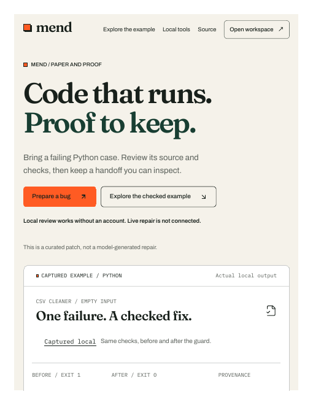

# Mend: Code that runs. Proof to keep.

Mend is an AI code-repair agent: it fixes bugs in your code and hands you a verification receipt showing exactly what changed and why, so you never have to blindly trust the AI.

**[Live demo](https://mend-smasher.vercel.app/)** · Python · FastAPI · Next.js · 150+ tests · CI

I originally built Mend aiming for the Nebius × NVIDIA hackathon, but didn't submit in the end, so it became my portfolio centerpiece instead. The Nebius Token Factory client code is real (it calls NVIDIA's Nemotron model with credential redaction and no blind retries); live provider runs stay behind safety gates by design.

## Current status (31 Oct 2026)

- Full source is public in this repository (MIT), CI running
- Live demo site working: [mend-smasher.vercel.app](https://mend-smasher.vercel.app/)
- 150+ tests, offline verification receipts, local bug-review flow
- Live Nebius/Nemotron execution stays gated behind safety checks — by design, not by accident

## Build history

The dated log below is the real day-by-day build history — kept as-is for transparency.

## Current integration status

**Local tools and runtime checks, 29 October 2026:** [current delivery scope and evidence limits](docs/DELIVERY_2026_10_29.md). The local tools accept bounded JSON source-map files with folder paths, while preserving exact source strings and retiring stale reviews. `MEND_TASK_COST_CAP` now reaches the assembled inference-reservation gate. CI installs and verifies the same hashed runtime dependencies as the backend deployment before running tests. These are offline/source improvements; consult the exact-commit Actions result for execution evidence. The public Vercel app connects to a status-only Render setup service: real hosted authentication, database/task operations and provider execution remain unavailable. Both existing holds remain active. Older dated checkpoints below are historical where they conflict.

**Readability update, 25 October 2026:** the public homepage now prioritizes the working local bug desk, shows the captured evidence at full width, and keeps the authenticated workspace on its own routes. Larger text and visible controls replace cramped inspection UI. Public browsing no longer bootstraps an unconfigured session. See [the frontend change and limits](docs/FRONTEND_CLEANUP_2026_10_25.md); exact-commit CI covers the real navigation, review/download, keyboard, mobile and retained workspace/sample journeys. Provider and hosted-database holds remain active.

**Offline test/install update, 25 October 2026:** [One command](docs/OFFLINE_DEMO.md) now checks the actual curated Python failure/correction, a protected two-file repository diff, tamper rejection, a simulated-service receipt export and exact JavaScript viewer binding. It preserves inspectable outputs and refuses overwriting existing directories. [Build/install the local receipt-viewer VSIX](docs/IDE_RECEIPTS.md#install-a-local-vsix), or download the exact-commit CI artifact. These checks do not establish live model repair, authenticated hosting or signed execution; both existing holds remain active.

**Roadmap implementation, 24 October 2026:** [six concrete statuses and usage guides](docs/ROADMAP_IMPLEMENTATION_2026_10_24.md). New bounded multi-file case/diff CLI, source-bound offline policy gate, membership/ownership-aware team receipt API/migration and a real local VS Code receipt inspector are available in source. The website replaces the blanket planned label with individual statuses and real guide links. These tools do not establish whole-repo live repair, hosted teams, required branch enforcement or trusted runtime evidence. Both holds remain; consult the final exact-commit checks.

**Hackathon readiness, 24 October 2026:** [complete blockers and work order](docs/RELEASE_READINESS_2026_10_24.md), [judge testing guide](docs/JUDGE_GUIDE.md) and [current submission draft](docs/HACKATHON_SUBMISSION_2026_10_24.md). The project is not yet ready for a provider-backed submission: hosted authentication, trusted live report/stop producers, actual model repair, public narrated video and final entry are unfinished. Both holds remain. The preparation transport and CLI now accommodate the editor's 200KB combined-source allowance even when JSON escaping expands the request; source and ordinary API limits remain enforced. Check the exact commit's CI before relying on this change.

**Backend integration, 24 October 2026:** the production proxy now permits authenticated stateless bug-contract preparation. The hosted database hold is enforced in the API and repository by `MEND_DATABASE_WRITES_ENABLED=false`. Production Next → Uvicorn/FastAPI transport has a reproducible fixture-identity check; CI now includes a disposable PostgreSQL migration/rollback fixture. Real hosted startup still needs the private Supabase service credential. See [backend integration and Render setup](docs/BACKEND_INTEGRATION_2026_10_24.md); consult the exact-commit Actions result for executed checks. Both existing holds remain active.

**Public Vercel frontend, 22 October 2026:** [Open Mend](https://mend-smasher.vercel.app/) or [try protected-test review](https://mend-smasher.vercel.app/fix) without installing anything. The public frontend passed signed-out desktop/mobile checks in light/dark themes, keyboard validation, exact JSON export and Clear/Undo behavior. It deploys from this repository's `frontend` directory; the older ChatGPT Site is a separate preview. Authentication and live execution remain unavailable until the trusted backend and existing release gates are completed. Both provider and hosted-database holds remain active.

**Offline completion pass, 22 October 2026:** `/fix` now reviews proposed protected tests and exports one request accepted by `prepare_bug_case.py --request`; no code is executed or uploaded by this flow. Evidence readers can bind an authorized persisted task lookup to its unique attached job. Missing API/runner/timing Dockerfiles are restored, with offline CI image builds and non-root smoke checks added. Local verification: 115 frontend unit tests, 44 focused backend tests, six required HTTP tests, the 39 existing browser cases and two new desktop/mobile proposal cases. Actual browser downloads round-trip through the CLI with exact source preservation. See [bug review](docs/BUG_CASE_REVIEW.md), [submission draft](docs/HACKATHON_SUBMISSION_2026_10_22.md) and [walkthrough script](docs/WALKTHROUGH.md). Check the exact-commit Actions result for Linux/image verification. Real hosted authentication, provider execution, independent stop authority, signed live receipts and the final public video remain unfinished; both user holds remain active.

**Public source snapshot, 22 October 2026:** GitHub App installation access and a write check now work. This delivery contains the full Next.js/FastAPI source and preserves both MIT notices. [Offline Linux CI](https://github.com/saihaanmohammed120-cell/Mend/actions) is configured; consult the run for the exact commit for its result. Earlier dated publication blockers below are historical. The public static Site remains separate from authenticated full-stack hosting. Live Nebius execution and database changes remain on hold.

**Frontend refinement, 21 October 2026:** public static Site version 20 now has a quieter captured-evidence frame, clearer unsigned provenance/source identities, grouped proof downloads, an expanded evidence key and a hardened keyboard skip link. The same evidence components are updated in this full-stack source. Fresh checks: 107 unit tests, 39 production Chrome cases, build/typecheck and six signed-out public light/dark/desktop/tablet/mobile scenarios. See [scope and verification](docs/EVIDENCE_UI_2026_10_21.md). This frontend release does not enable the backend provider loop or complete the six roadmap products.

**Roadmap continuation, 21 October 2026:** the screenshot's six roadmap capabilities are not complete. Flaky-test work now has an offline authenticated check-history analyzer, a fail-closed file/CI command and candidate-comparison integration. It flags disagreement for review without excluding tests or granting approval. Twenty-two focused tests pass; full Windows backend: 282 passed, seven skipped, four failures and 11 errors out of 304. Frontend was unchanged and its earlier browser results were not rerun. See [all six roadmap statuses](docs/ROADMAP_STATUS_2026_10_21.md) and [history gate usage](docs/CHECK_HISTORY.md). GitHub required checks, public deployment, automatic quarantine and the remaining roadmap products are unfinished.

**21 October 2026:** Python bug-case review now has an offline preparation helper, an authenticated stateless preparation endpoint and source-bound comparative signed-report validation. The `/fix` intake remains local-only; the new recipe does not run through the live CSV engine. Paired authenticated evidence readers can be explicitly injected into the runner, with project/attempt/source binding and durable envelope digests; external authorities and context lookup remain unfinished. See [bug review contracts](docs/BUG_CASE_REVIEW.md) and [reader protocol](backend/docs/TRUSTED_EVIDENCE_READERS.md). Live execution and database changes remain on hold. The compact local intake passed 107 unit tests and 34 production Chrome cases; a silent offline UI draft was recorded. Full Windows backend: 270 passed, seven skipped, four failures and 11 errors. See [current delivery and remaining work](docs/CONTINUATION_2026_10_21.md). GitHub source publication remains blocked by missing connector installation access; the static Site is unchanged.

**20 October 2026:** the hosted landing is now public and version 19 qualifies its unmeasured stop bound. The full-stack source adds compact sign-in/task views, secure local HTTPS instructions and an early-wakeup deadline fix. Fresh checks: 100 frontend unit tests, 28 production-browser cases, typecheck/lint/build, and focused backend regressions pass. The full Windows backend suite still has POSIX failures. See [current delivery and limits](docs/CONTINUATION_2026_10_20.md). These full-stack changes are not deployed to the separate static landing; GitHub source publication and live execution remain blocked.

**19 October 2026:** the complete source ZIP is recovered. Stop-proof validation now guards runner observation, service resolution, historical attempts, live receipt checks and cancellation completion. Browser animation callbacks and reduced-motion hydration are fixed. See [the continuation record](docs/CONTINUATION_2026_10_19.md) and [fresh verification](docs/OFFLINE_VERIFICATION_2026_10_19.md) for exact scope and remaining failures. Live Nebius execution remains on hold. The public [Mend repository](https://github.com/saihaanmohammed120-cell/Mend) exists with MIT licensing; application-file publication is blocked by connector installation access. The following dated checkpoints are historical where they conflict with this update.

Latest continuation, 17 October 2026: [full-stack readiness](docs/FULLSTACK_READINESS.md) now verifies the local production Next.js → FastAPI → real Supabase path while execution stays locked. The canonical workbench adds separate API/database/execution states and a real connection recheck; this panel has not been published to the static landing page or accepted in a browser. The existing version-18 landing desktop paths have their separate [browser acceptance record](docs/BROWSER_UI_ACCEPTANCE.md). Older checkpoints below retain the scope and dates of their observations.

This source preserves the existing implementation and the Paper and Proof design contract. The current implementation uses Next.js 16.4.1, React 19.3.1 and Tailwind CSS 4.3.3; the original planning documents remain historical baselines. The framework migration, dependency findings and local verification are recorded in [framework migration evidence](docs/FRAMEWORK_SECURITY_MIGRATION.md) and the subsequent [tooling follow-up](docs/TOOLING_FOLLOWUP.md).

The `/sample` route uses explicitly simulated evidence; `/` is the public landing, `/fix` is local intake, `/tools` contains local review, and `/sign-in` plus owned-task routes contain the authenticated workbench integration. Browser acceptance is recorded per dated delivery; a real provider repair run, measured cancel-to-stop latency and a live verified receipt remain unverified. Backend/database evidence from earlier continuations is retained with its dates in [the frontend checkpoint](docs/FRONTEND_INTEGRATION_CHECKPOINT.md) and [Phase 2 evidence](docs/PHASE2_DATABASE_INITIALIZATION.md); those observations were not rerun during the framework migration.

The reference-inspired proof-file check and roadmap ledger are documented in [the research/implementation checkpoint](docs/RESEARCH_IMPLEMENTATION_CHECKPOINT.md). The hash action checks file consistency only; captured provenance remains unsigned, and deployed browser acceptance remains unverified.

The screenshot-guided evidence disclosures, proof-first page order and local repair-case preparation are documented in [the screenshot/workflow review](docs/SCREENSHOT_WORKFLOW_REVIEW.md). This local case workflow exports input only; it does not create an execution task or receipt.

The follow-up [repair-case and handoff refinement](docs/UI_REFINEMENT.md) adds Undo clear, direct review editing and honest command copying. Browser acceptance remains unverified.

The configured Supabase reference is `uwkdrmdflzverflcfkgk`. GitHub App access was restored on 22 October; current source and CI results are available through this repository and its Actions page. The new offline UI recording does not establish the final narrated provider walkthrough.

## File structure

| Path | Purpose |
| --- | --- |
| `backend/mend/` | Existing FastAPI API, authentication, domain logic, orchestration, adapters and workers |
| `backend/migrations/` | Existing schema and RPC definitions; cloud execution unverified |
| `backend/scripts/` | Existing genuine HTTP/Postgres verification and provider spike tools |
| `backend/tests/` | Existing regression and integration checks |
| `backend/docs/baseline/` | Preserved TRD, UI/UX brief, App Flow and schema documentation |
| `frontend/app/` | Existing Next.js workbench and simulated SSE route |
| `frontend/components/` | Existing task card and receipt components |
| `frontend/lib/`, `frontend/tests/` | Existing client protocol, motion, tilt and checks |
| `docs/CONNECTION_CHECKPOINT.md` | Current observed integration results and next steps |
| `LICENSE` | Preserved MIT license |

## Local development

To publish the current frontend on Vercel, import this repository with **Root Directory `frontend`** and the Next.js preset. The versioned Vercel config uses the existing lockfile install and production build. Follow [Vercel deployment and public acceptance](docs/VERCEL_DEPLOYMENT.md); frontend deployment does not enable the gated backend/provider loop.

Backend setup, existing checks and safety constraints are documented in [backend/README.md](backend/README.md). Frontend setup is documented in [frontend/README.md](frontend/README.md). Use their existing package definitions and lockfiles. Dependencies and private environment files are intentionally excluded from this source checkout.

Do not enable live execution based solely on a database URL or API key. The inherited deadline, ownership, isolation, evidence and release gates remain in force. Provider acknowledgement is not infrastructure-stop evidence. The `/sample` route remains simulated. The captured CSV example records actual local Python execution with unsigned in-toto/SLSA provenance; it does not establish live Nebius execution.

## Next integration step

Verify the published source and exact-commit offline Linux CI result, then complete the authenticated browser workflow. Follow [the offline walkthrough plan](docs/WALKTHROUGH.md). Before a separately authorized paid Nebius/Nemotron spike, integrate a reviewed independent infrastructure-stop evidence reader as well as private credentials, infrastructure and cost settings. The current live spike entry point blocks before provider-client allocation because it cannot yet assemble that reader. Record inference/provisioning latency and cancel-to-stop time before enabling live execution. Keep provider credentials server-side. Public/sample browser checks, local tests and a production build do not establish the authenticated provider repair loop.
