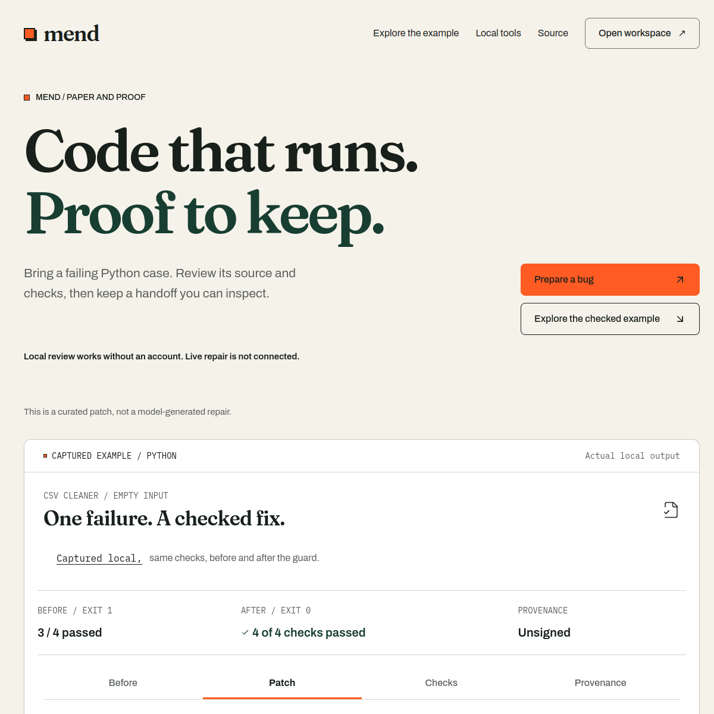

# Mend: Code that runs. Proof to keep.

Mend is an AI code-repair agent: it fixes bugs in your code and hands you a verification receipt showing exactly what changed and why, so you never have to blindly trust the AI.

**[Live demo](https://mend-smasher.vercel.app/)** · Python · FastAPI · Next.js · 550+ tests · CI

I originally built Mend aiming for the Nebius × NVIDIA hackathon, but didn't submit in the end, so it became my portfolio centerpiece instead. The Nebius Token Factory client code is real (it calls NVIDIA's Nemotron model with credential redaction and no blind retries); live provider runs stay behind safety gates by design.

## Current status (31 Oct 2026)

- Full source is public in this repository (MIT), CI running
- Live demo site working: [mend-smasher.vercel.app](https://mend-smasher.vercel.app/)
- 550+ tests, offline verification receipts, local bug-review flow
- Live Nebius/Nemotron execution stays gated behind safety checks — by design, not by accident

## Build history

The day-by-day build log lives in [docs/BUILD_LOG.md](docs/BUILD_LOG.md) — kept as-is for transparency.

## File structure

| Path | Purpose |
| --- | --- |
| `backend/mend/` | Existing FastAPI API, authentication, domain logic, orchestration, adapters and workers |
| `backend/migrations/` | Existing schema and RPC definitions; cloud execution unverified |
| `backend/scripts/` | Existing genuine HTTP/Postgres verification and provider spike tools |
| `backend/tests/` | Existing regression and integration checks |
| `backend/docs/baseline/` | Preserved TRD, UI/UX brief, App Flow and schema documentation |
| `frontend/app/` | Existing Next.js workbench and simulated SSE route |
| `frontend/components/` | Existing task card and receipt components |
| `frontend/lib/`, `frontend/tests/` | Existing client protocol, motion, tilt and checks |
| `docs/CONNECTION_CHECKPOINT.md` | Current observed integration results and next steps |
| `LICENSE` | Preserved MIT license |

## Local development

To publish the current frontend on Vercel, import this repository with **Root Directory `frontend`** and the Next.js preset. The versioned Vercel config uses the existing lockfile install and production build. Follow [Vercel deployment and public acceptance](docs/VERCEL_DEPLOYMENT.md); frontend deployment does not enable the gated backend/provider loop.

Backend setup, existing checks and safety constraints are documented in [backend/README.md](backend/README.md). Frontend setup is documented in [frontend/README.md](frontend/README.md). Use their existing package definitions and lockfiles. Dependencies and private environment files are intentionally excluded from this source checkout.

Do not enable live execution based solely on a database URL or API key. The inherited deadline, ownership, isolation, evidence and release gates remain in force. Provider acknowledgement is not infrastructure-stop evidence. The `/sample` route remains simulated. The captured CSV example records actual local Python execution with unsigned in-toto/SLSA provenance; it does not establish live Nebius execution.

## Next integration step

Verify the published source and exact-commit offline Linux CI result, then complete the authenticated browser workflow. Follow [the offline walkthrough plan](docs/WALKTHROUGH.md). Before a separately authorized paid Nebius/Nemotron spike, integrate a reviewed independent infrastructure-stop evidence reader as well as private credentials, infrastructure and cost settings. The current live spike entry point blocks before provider-client allocation because it cannot yet assemble that reader. Record inference/provisioning latency and cancel-to-stop time before enabling live execution. Keep provider credentials server-side. Public/sample browser checks, local tests and a production build do not establish the authenticated provider repair loop.
