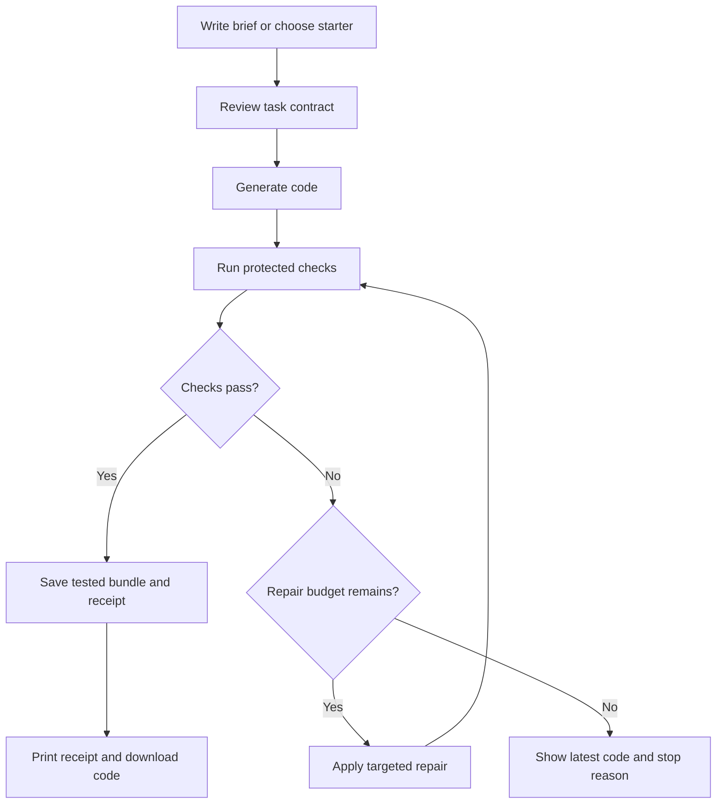
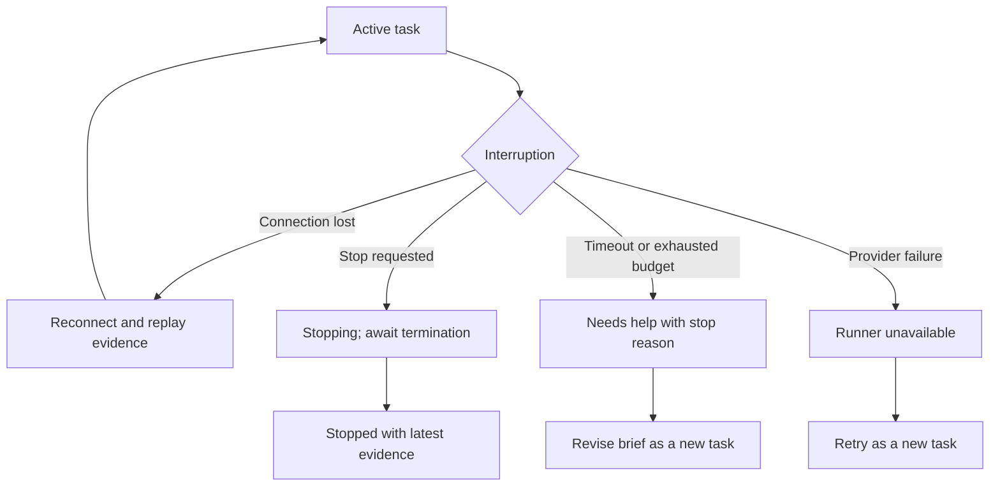

# Mend — AppFlow

**File:** `APP_FLOW.md`  
**Version:** 1.1 — audited flow  
**Date:** 2026-10-11  
**Workflow stage:** 3 — AppFlow  
**Foundation:** Corrected Mend PRD and `TRD.md` v1.1; audit details in `PLAN_AUDIT.md`  
**Purpose:** Define screens, navigation, user actions, system responses, and visual choreography before further implementation.

## 1. Position in the video workflow

The supplied video identifies the sequence as:

1. Product Requirements Document — PRD.
2. Technical Requirements Document — TRD.
3. **AppFlow — this document.**
4. UI/UX Design Brief.
5. Backend Schema.

AppFlow translates the product and technical requirements into an end-to-end experience. The following UI/UX brief can develop these screen specifications into detailed layouts; the backend schema can implement the data relationships already outlined in the TRD. This file defines intended behavior, not completed integration.

## 2. Experience direction: a tactile workbench

**Design statement:** Mend is a shared desk where a coding task becomes a checked piece of work. The interface gives the brief, the changing code, and the evidence a physical place.

The three signature moments are:

- **The task card:** A raised white card on warm paper, with clear typography and a restrained hover tilt. It is the main object of attention.
- **The repair trail:** Numbered attempt markers and readable diffs show what changed and which checks were rerun. Earlier failures remain available.
- **The printed handoff:** A receipt emerges from a physical slot only after verified success has been saved. Source download and check evidence remain immediately accessible.

Use a compact branded header, one clear main action, and purposeful space. Do not add a marketing hero, KPI tiles, floating chat bubbles, decorative AI avatars, or perpetual background animation to the workbench. The product’s personality comes from material, typography, interaction, and honest evidence.

### Visual rules shared by every screen

| Element | Required treatment |
|---|---|
| Canvas | `#F5F2EA`, static noise overlay at 5% opacity |
| Surfaces | `#FFFFFF`, `2px solid #18201B` border, 20px panel corners |
| Primary panel shadow | `8px 8px 0px #18201B`, zero blur |
| Text and shadows | `#18201B` |
| Primary action | `#FF5B23` background with ink text; 12px corners |
| Successful checks | `#183E32`, accompanied by a check icon and words |
| Failed checks | `#B42318`, accompanied by an alert icon and words |
| Typography | Inter/system sans; IBM Plex Mono/system mono for code and logs |
| Spacing | 4px base; primary steps of 8, 16, 24, and 32px |
| Icons | lucide-react, consistent stroke weight; text labels on key actions |
| Motion | Framer Motion springs: stiffness 100, damping 10 |
| Depth | 1200px perspective; task card hover capped at ±3° on each axis |

The entire experience stays light. Logs and code use readable paper surfaces rather than introducing a full-screen neon terminal theme.

## 3. Navigation and screen inventory

The workbench is the home screen. Task setup, execution, repair, and handoff are states of one continuous workspace, rather than a series of disconnected pages.

| Screen / route | Main purpose | Primary action | Secondary actions |
|---|---|---|---|
| `/` — New workbench | Write a task or select a curated starter | Review task | Open recent work |
| `/sign-in` — Account access | Establish ownership when required | Continue sign-in | Return to draft |
| `/tasks/{id}` — Contract review | Review proposed scope and mandatory checks | Start Mend | Edit brief |
| `/tasks/{id}` — Active work | Follow generation, execution, and repairs | Stop | Inspect diff, checks, or logs |
| `/tasks/{id}` — Passed work | Inspect verified result and receipt | Download code | Review diff, view receipt, start another task |
| `/tasks/{id}` — Incomplete work | Understand the stop reason and retain useful output | Edit task or retry as a new task | Download latest code, inspect evidence |
| `/tasks/{id}/receipt` — Receipt detail | Read the persisted handoff in a durable view | Download code | Download receipt JSON, return to task |

Recent work opens in a drawer from the header. It lists title, date, terminal/current status, and repair count. Selecting an item restores the existing task; it never submits the task again. Empty and expired history states use plain explanations.

Unauthenticated draft text remains in session storage while account access is completed; source uploads are not cached by default. Clear local drafts on explicit discard or sign-out. Existing tasks and artifacts require verified ownership. Do not imply that a local draft is a saved server task.

## 4. Main journey

Generation, patch validation, infrastructure failures, cancellation, timeout, and overall budgets can stop this journey before the next execution. The diagram’s repair branch is always bounded by the TRD’s safety rules.

### 4.1 Start: an inviting task card

**Visible composition:** A small Mend wordmark and Recent work control sit above a large task card. The card has a short headline, a substantial text field, a starter selector, and example tasks. A small numbered margin reads “01 / Brief.”

Suggested copy:

- Headline: **“Make something work.”**
- Prompt label: **“What should Mend build or fix?”**
- Example: **“Build a CSV cleaner that removes duplicate rows and reports missing values.”**
- Primary action: **“Review task.”**

Typing changes only the draft. The Review task button is disabled for empty input, with an understandable label and no error animation. File input accepts only the bounded sources supported by the TRD; unsupported uploads show an actionable explanation.

**Entrance:** Header, card, and supporting controls appear in a short stagger. The card rises at most 16px with the shared spring. Fine-pointer hover adds slight depth; touch and keyboard use a stable surface.

**Exit condition:** The brief is valid and a contract can be prepared. No job starts yet.

### 4.2 Contract review: agree on the work

The task card expands into a concise review sheet containing:

- Expected behavior and relevant input/output examples.
- Runtime and approved entry point.
- Editable files and protected mandatory checks.
- Clearly stated limits: **60 seconds per job; up to 3 repairs.**
- Checks that are outside the task’s scope.

The primary action is **“Start Mend.”** The secondary action is **“Edit brief.”** Check details are expandable; essential scope and limits remain visible.

Review uses an editable proposed contract. Creating a task does not start work. Contract edits require the expected version; Start Mend calls the explicit Start endpoint, checks feasibility, then freezes the validated contract atomically before execution. A task with missing expected behavior, unsupported scope, no mandatory tests, or an unresolved execution feasibility gate remains in review with a specific reason. Model-proposed checks are presented for review and cannot silently replace independent protected checks.

Starting uses one idempotent submission. Disable repeated submission while its outcome is pending. If the network response is uncertain, reconcile the original request instead of creating another task. Editing an active or completed frozen task creates a new task revision.

**Visual transition:** The brief folds into a compact task header while the code and evidence areas enter. Preserve the task title and context throughout the transition.

### 4.3 Active work: show useful evidence

Desktop uses three regions:

| Region | Contents | Behavior |
|---|---|---|
| Context rail | Brief, files, contract summary | Compact and collapsible |
| Main surface | Source / diff tabs | Largest area; file selection remains stable |
| Evidence rail | Check results, attempt trail, Logs tab | Current attempt selected by default |

The task header always exposes status, overall elapsed time, execution count, repair count, and Stop. Show code executions as **“Run 1 of 4”** and repairs separately as **“Repairs used: 0 of 3.”** A reserved repair generation consumes a repair slot even if no valid patch results.

| Backend state | Visible label | Required presentation |
|---|---|---|
| `writing` | Writing the first draft | Show accepted files as they become available; no fabricated code or logs |
| `waiting_runner` | Waiting for the runner | Explain queue/provisioning time; show the active job deadline |
| `running` | Checking the work | Show commands, test outcomes, stdout, and stderr as available |
| `fixing` | Repairing the failed check | Identify the relevant failure and the repair slot being used |
| `finalizing` | Saving the verified result | Keep checks visible; withhold the receipt until persistence succeeds |

Keep provider IDs, image digests, and raw diagnostic details in expandable evidence. They support review without dominating the everyday workflow.

Logs arrive incrementally through SSE. Render them as text. Preserve scroll position when reading older output and offer “Jump to latest.” If output is truncated, show a visible truncation marker; never present an incomplete log as complete.

### 4.4 Repair: reveal the change, retain the history

When a check fails, the evidence rail highlights the failing check and adds an attempt marker. Mend displays a factual sentence such as **“The empty-input check failed. Preparing a repair.”**

An accepted repair appears as a focused diff. Keep the selected file and editor scroll position stable. The next run executes the entire mandatory suite, not just the previously failing check.

The attempt trail remains clickable. Each attempt exposes its source snapshot, changes, checks, timing, job evidence, and logs. Never overwrite earlier failures with the final green result.

**Motion:** A new attempt marker enters once. Changed-line emphasis fades once. Avoid shaking panels, repeated flashing, or reanimating every log event.

### 4.5 Success: the printed handoff

Before the interface enters success, the backend verifies all required checks, protected hashes, report completeness, deadline compliance, and artifact identity, then persists the receipt and completion event.

The code surface remains present. A dedicated receipt panel becomes active beside it:

1. The slot is already visible as a restrained ink line in a raised printer surface.
2. The receipt paper slides downward from behind the slot through an overflow-clipped wrapper.
3. Check counts, repair history, and download actions become readable without waiting for a long animation.

Receipt hierarchy:

- **“Required checks passed.”**
- Task title and receipt identifier.
- Named checks and passed/failed/skipped totals.
- Runs completed and repairs used.
- Duration, tested snapshot reference, and reproduction details.
- Explicit omitted checks and limitations.

The primary action is **“Download code.”** Secondary actions are **“Review changes”** and **“View receipt.”** Receipt detail also offers JSON download.

Do not use “100% correct,” “production-ready,” or similar claims based solely on passing the declared checks. A previously completed task reopened from history shows its receipt immediately; printing does not replay on every visit or reconnect.

## 5. Alternate journeys and recovery

### Failure and incomplete work

Keep the workbench layout intact. Replace the success area with a clear outcome panel containing the last failure, named stop reason, completed attempts, and latest available source.

| Condition | Example heading | Next action |
|---|---|---|
| Three repairs consumed | Repair limit reached | Edit task; download latest code |
| Job reaches its deadline | The job reached its 60-second limit | Review scope; create a revised task |
| Repeated failure without new evidence | The same check is still failing | Inspect failure; revise the task |
| Inference unavailable | Code generation is unavailable | Retry as a new task when available |
| Runner/provider unavailable | The runner is unavailable | Retry as a new task after resolution |
| Invalid or protected-file patch | The proposed change could not be applied | Show reason; consume the reserved repair slot if applicable |
| Missing report or artifact mismatch | The result could not be verified | Retain diagnostics; block successful handoff |
| Overall task budget exhausted | The task reached its overall limit | Show used budget and latest evidence |

Latest-code downloads are labeled **“Unverified latest code.”** They never receive a passed receipt or success-print animation. Retry is explicit and produces a linked new task; it does not reset counters on the original task.

### Cancellation

Stop is available throughout active work. A click records durable cancellation without an extra confirmation dialog. The control becomes **“Stopping…”**, further dispatch is blocked, and the interface waits for confirmed termination.

Only a confirmed backend `stopped` event produces the heading **“Stopped.”** A disconnected stream or local button click does not prove remote termination. The stopped view retains available source and evidence. Cancellation committed before success blocks late receipts. A task already committed as passed stays completed; Stop is unavailable in that terminal view.

### Connection loss, refresh, and uncertain requests

Connection status is a separate interface indicator, not a task outcome. Show **“Connection interrupted. Reconnecting…”** while keeping the last known code and evidence visible. Do not manufacture progress while disconnected.

On refresh or return to `/tasks/{id}`, fetch durable task state, restore evidence, and reconnect from the last event sequence. Deduplicate replayed events. Reconnection must not launch another job or replay the success animation.

If submission acknowledgement is lost, reconcile the original idempotency key. If receipt persistence is pending after a verified run, use `finalizing` and show **“Saving the verified result…”**; do not rerun the code or print a receipt before persistence succeeds. If the overall budget expires, show **“Checks passed; receipt unavailable”** with retained evidence rather than mislabeling the checks as failed.

### Expired and unauthorized work

After the 24-hour retention window, show **“This task has expired.”** Offer a new task action without claiming that old source remains available. Unauthorized task links reveal no task title, logs, source, or receipt metadata.

## 6. Responsive behavior and access

| Viewport | Layout |
|---|---|
| Wide desktop, approximately 1280px+ | Three regions; code occupies the largest share |
| Tablet / compact desktop | Context collapses; code and evidence remain side by side where practical |
| Narrow mobile | One column; Files / Changes / Checks tabs; receipt follows result summary |

The exact breakpoints can be refined in the UI/UX brief. No horizontal page overflow is acceptable; code and logs may scroll inside their own regions. Narrow screens retain status and Stop without relying on hover.

All core actions work by keyboard. Tabs expose their selected state, dialogs/drawers manage focus, and disabled actions include understandable reasons. Status includes words and icons, never color alone. Touch targets are at least 44px; contrast meets WCAG AA.

Reduced-motion mode removes tilt, paper sliding, and spatial entrances. Success information and actions appear immediately. Status announcements are polite and concise; raw logs do not become a continuous screen-reader announcement stream.

## 7. Interaction choreography

| Moment | Choreography | Guardrail |
|---|---|---|
| Initial arrival | Header → task card → supporting controls; short stagger | Shared spring 100/10; no blocking splash screen |
| Task-card hover | Pointer-driven ±3° tilt, returning to neutral on exit | Fine pointers only; no layout movement |
| Start work | Brief condenses; code and evidence enter within the same workspace | Preserve task identity and avoid a full-page jump |
| Repair accepted | Diff receives brief emphasis; next attempt marker enters | No repeated full-panel animation |
| Check passes | Icon and label update | Actual result required; no synthetic progress percentage |
| Receipt saved | Paper emerges downward from its slot | Persisted receipt event required; run once per live completion |
| Action pressed | Button moves toward its hard shadow | Visible focus; retain a stable hit target |
| Reduced motion | Immediate state changes or brief opacity transitions | No loss of content, hierarchy, or actions |

Transitions communicate a real event. They must never imply completion, provider activity, or progress that the backend has not reported.

## 8. Product and technical boundaries

- **Task authority:** FastAPI and durable worker state own limits and transitions. Frontend counters are presentations of persisted values.
- **Job limit and blocker:** The product requires a hard 60-second total job lifetime. Current Nebius documentation specifies a one-hour native timeout minimum. Until an adequate enforcement mechanism is proven or the specification is explicitly amended, live Start is unavailable with “Live execution is not ready.” A countdown is never proof of enforcement. Curated demo mode remains explicitly labeled.
- **Repair limit:** At most three repairs and four code executions. A repair cannot reset the task’s overall budget.
- **Evidence:** SSE carries ordered persisted events. History and refresh reconstruct the same task rather than creating another one.
- **Success:** Supabase stores a JSON receipt only for a verified passing snapshot. The downloaded bundle must match the tested snapshot hash.
- **Demo separation:** Curated or simulated evidence is visibly labeled. Demo output cannot be presented as real Nebius execution or a production receipt.
- **Scope edits:** A frozen contract is immutable; revised work creates a linked new task.

## 9. AppFlow acceptance checklist

- [ ] A first-time visitor can identify the task input and primary action immediately.
- [ ] Task setup, contract review, active work, and handoff form one coherent workspace.
- [ ] Mandatory checks and limits are visible before Start Mend.
- [ ] The interface distinguishes generation, waiting, running, and fixing.
- [ ] Code, check results, and attempt history remain inspectable throughout repairs.
- [ ] Maximum repair count, hard job timeout, repeated failure, and provider failure have distinct outcomes.
- [ ] Stop remains accessible and reports confirmed termination honestly.
- [ ] Refresh and reconnect recover the existing task without duplicate work.
- [ ] Only a persisted verified receipt triggers the printer effect.
- [ ] Incomplete code is labeled unverified and never receives success styling.
- [ ] The exact tested source can be downloaded with reproduction details.
- [ ] Mobile, keyboard, contrast, and reduced-motion behavior are defined for every core action.
- [ ] Warm paper, ink shadows, orange actions, restrained depth, and custom receipt composition are consistent across states.

## 10. Next document

**Stage 4: `UI_UX_DESIGN_BRIEF.md`.** The companion brief defines annotated screen layouts, component variants, typography, responsive measurements, and interaction details. Its design boards include new-task, active repair, successful handoff, and mobile outcomes. Acceptance and live readiness remain separate from visual completion.

Then produce **Stage 5: the Backend Schema** with executable migrations, ownership policies, indexes, and state-transition constraints grounded in the TRD. Further implementation follows these documents and their feasibility gates.
