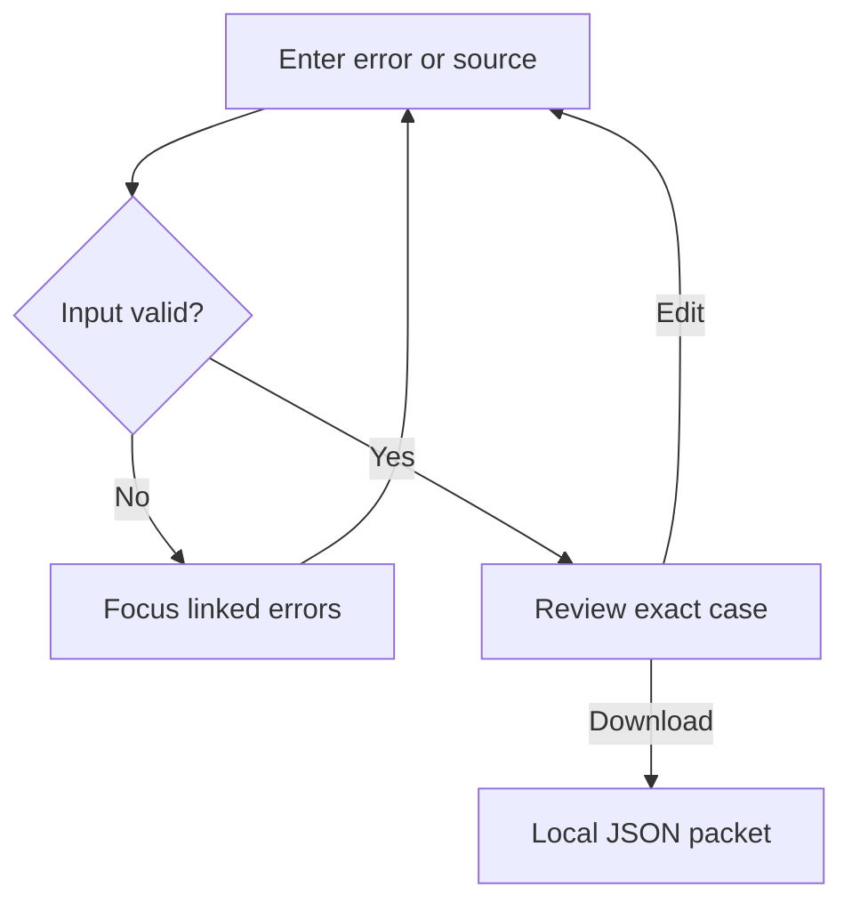

# Mend — screenshot corrections and a useful local workflow

16 October 2026. This checkpoint covers the supplied screenshots and the authorized Paper and Proof UI/workflow improvement. It does not certify the entire application or replace dated backend/provider evidence.

## Published result

Site: https://mend-paper-proof.bravebadge32.chatgpt.site/ . Sites returned **succeeded** for version **16**, source commit `dd937a48038c9a0680bbb633a055bb01eb518b15`, at `2026-10-16T15:58:39.631252+00:00`. The existing custom audience was preserved. External judge access remains **unverified**. [EVIDENCE S6 — native Sites save/deploy]

The new page order is **captured repair → actual loop diagram → downloadable handoff → local case preparation → planned roadmap → footer**. Functional results precede future promises. The same shared component owners are used by the hosted Site and canonical Next application. The authenticated Next workbench keeps its existing task path; local case preparation and the roadmap now follow its functional panels.

## Screenshot-by-screenshot findings

All supplied images were opened successfully using `view_image`. The earlier missing-file message did not prevent inspection in this continuation. These observations describe the supplied captures, not a fresh Playwright session. [EVIDENCE S1]

| Screenshot ending | Visible observation | Applied change or preserved behavior |
| --- | --- | --- |
| `210301(1).png` | A considered serif hero sits beside a long, dense Patch panel. The complete code extends past the viewport. | Show exact opening context initially; disclose complete source explicitly. Keep type size, headline, wordmark, palette and evidence summary. |
| `210313(1).png` | The proof card footer and large left-column gap prolong the hero before the next section. | Reduce default evidence height through progressive disclosure rather than shrinking code or deleting facts. No fixed-height clipping. |
| `210323(1).png` | The diagram correctly sends Repair back to Run; only passing checks reach Receipt. | Preserve the topology and its provider-workflow disclosure. No invented diagram defect or decorative replacement. |
| `210329(1).png` | All roadmap rows appear before the actual handoff. A long blank area sits beneath the roadmap introduction. | Move the handoff before the roadmap; use a full-width roadmap introduction and a compact outlined ledger. |
| `210335(1).png` | The practical bundle, reproduction command and real download are present but late in the journey. | Retain those controls and move the useful result earlier. Add a real local next action rather than a fake Run control. |

Already visibly correct in the supplied screenshots: serif wordmark, coral/mint treatment, restrained texture, offset card surfaces, repair-loop arrows, captured-local labels and the unsigned status. Patched line three visibly contains `return [], 0`; no missing line number is evidenced in these captures.

## What changed

### Evidence density

Before and Patch panels initially show their exact opening source lines, including the empty-input guard. Native **Read complete original source** and **Read complete checked source** disclosures retain every literal source line, continuous numbering and change markers. Complete listings are keyboard-focusable scroll regions. Original raw output, hashes and downloads remain available.

The provenance view retains its visible **Unsigned** label, artifact identity, standard-format description and signature boundary. Long exact fields move behind **Inspect all provenance fields**. The existing file-hash action remains separate from signing or execution evidence. No new signature or transparency entry was created.

The roadmap keeps the same planned capabilities and **Not yet built** label. Outlined rows occupy a compact desktop ledger and stack at narrow widths. It remains read-only.

These are implemented source changes. Post-change desktop/mobile appearance, containment, focus rendering and interactions remain **unverified** without browser execution. [EVIDENCE S3/S5/S7 — source changes, generated artifact checks, unavailable browser tooling]

### A genuine local app workflow

**Bring the next bug** lets a developer enter an error, optional original Python source and expected behavior, then inspect and download the validated case JSON. A **Use the captured CSV case** action fills the fields with the actual captured example’s original source. **Clear fields** is a real reset.

The implementation reuses `prepareBugIntake`, `previewSource`, `serializeBugIntake` and `beginBugIntakeDownload`; it does not introduce a competing packet contract. Source is preserved exactly in the export. Every field edit invalidates the prepared packet. Validation preserves input, focuses a linked error summary and opens a closed source disclosure before focusing its invalid field. Successful preparation focuses the review panel.



Preparation and export make no backend request. The interface reports **Download requested**, because a browser download request does not prove a file was saved. Blob URLs are released after use and on unmount. Download failure preserves the reviewed packet.

The packet explicitly records investigation and execution as `not_run`, and regression as `not_generated`. It is not a diagnosis, generated fix, applied patch, task, signed artifact or verification receipt. Fields are kept in application page memory; this component does not persist them to browser storage or a database. The existing standalone `/fix` route is preserved.

## Review findings corrected before publication

| Finding | Correction | Evidence |
| --- | --- | --- |
| Named inputs inside a native form could submit pasted content through the default browser submission path before hydration. | Remove the native form and submit control. Use a labeled local form region and explicit button handlers, with no native submission path. | Independent source review; structural regression; generated HTML check. |
| React ref callbacks can receive `null`, but the initial ref record excluded it. | Include nullable node values in the ref type. | Independent review; successful TypeScript/build. |
| An initial JSX closing-tag error prevented component compilation. | Correct the tag before packaging. | Actual compiler failure, corrected source, subsequent successful checks. |
| Existing isolated workbench tests did not recognize the new child component. | Extend the child stub while retaining the original draft-persistence assertions. | Initial harness failure; final full test rerun. |

No failing check was presented as success. The independent reviewer confirmed both substantive findings were resolved in the current source. The review was bounded and did not establish browser acceptance or whole-project security.

## Design research and imagery decision

The existing catalog was reused, not described as newly audited. A fresh recount found **126 recorded attempts**, **121 successful HTML records**, and **116 counted distinct sites**. Those are source/metadata observations, **not rendered visual audits, popularity research or evidence of what most people prefer**. The catalog remains in `docs/research/reference-catalog.json` and `.csv`. [EVIDENCE S2 — catalog recount]

Exact `https://motionsits.io/` was inaccessible through retrieval. `https://motionsites.ai/` is a plausible intended reference, explicitly an inference. Its public catalog was inspected for section-specific art direction. No paid prompt, code, image or branding was copied.

Focused current sources informed the implementation:

| Primary source | Useful principle | Mend adaptation |
| --- | --- | --- |
| [MotionSites](https://motionsites.ai/) | Specific direction for different page sections. | Preserve Paper and Proof while distinguishing evidence, local work and planned capabilities. |
| [Linear interface refresh](https://linear.app/now/behind-the-latest-design-refresh) | Main work takes precedence over competing chrome. | Compact evidence context and useful controls before roadmap content. |
| [GOV.UK check answers](https://design-system.service.gov.uk/patterns/check-answers/) | Review entered information before a consequential next step. | Inspect exact local inputs before JSON export; preserve edits. |
| [GOV.UK error summary](https://design-system.service.gov.uk/components/error-summary/) | Link a focused summary to matching field errors. | Focusable summary and direct field navigation. |
| [Motion accessibility](https://motion.dev/docs/react-accessibility) | Account for reduced-motion preferences. | Keep new work controls stationary; retain existing motion specifications. |
| [W3C interaction animation](https://www.w3.org/WAI/WCAG22/Understanding/animation-from-interactions.html) | Nonessential motion should be disableable. | Add no scroll-driven effects or animated validation. |
| [Sigstore verification](https://docs.sigstore.dev/cosign/verifying/verify/) | Identity and issuer verification are substantive requirements. | Preserve the distinction between hash consistency and signature verification. |

These are research inputs, not usability-test results. Existing code, literal check output and the authored flow diagram provide relevant visual evidence. Stock photos or fabricated product imagery would add no proof, so none were added. No research establishes a guaranteed hackathon outcome or a winning percentage.

## Verification actually run

```text
[ACTUAL LOCAL COMMAND OUTPUT SUMMARY]
Frontend tests:       85 passed, 0 failed, 0 skipped
TypeScript:          exit 0
Lint:                exit 0
Production build:    exit 0
Hosted build/QA:     passed
Browser discovery:   21 cases; 0 executed
Sites deployment:    succeeded
```

New handler tests exercise invalid input, focused errors, exact source export, stale-packet invalidation, URL cleanup, closed-source focus and failed-download preservation. These use the actual component handlers with injected DOM/download boundaries; they are not a real browser session. Existing evidence, protocol and tilt regressions remain in the full suite. [EVIDENCE S4 — `exec_command`, `npm test`, typecheck/lint/build]

Hosted QA checks actual generated HTML, proof bytes, ZIP contents, source numbering, unsigned provenance, fingerprint bindings, source disclosures, section order and absence of native case submission or export before validation. Shared canonical/hosted owners compare byte-identically. [EVIDENCE S5 — native source workflow, Python artifact checks and byte comparisons]

No Playwright MCP, DevTools MCP or control-browser capability is exposed. Plugin discovery did not supply a usable browser controller. Browser cases were only discovered; no preview server, browser installation, alternate login or visual acceptance claim occurred. [EVIDENCE S7 — tool inventory, plugin search, Playwright discovery]

Raw current logs: `docs/verification/screenshot-workflow-*`. These local results are not evidence of a Nebius run or newly executed CSV capture; the existing dated local capture was reused unchanged.

## Remaining problems and next milestone

| Gate | Current status |
| --- | --- |
| Actual desktop/mobile browser acceptance, including the new download and error workflow | **Unverified.** Requires the missing permitted browser capability. |
| Genuine Nebius/Nemotron repair run and cancel-to-actual-stop measurement | **Unverified.** No provider call or measurement occurred in this continuation. The independent stop-evidence integration and private provider prerequisites remain. |
| OIDC/cosign signature and transparency evidence | **Unverified; provenance remains unsigned.** A hash match cannot close this gate. |
| Diagnosis hallucination checking and tiered merge approval | **Unverified / not advertised as implemented.** No fake controls were added. |
| Current FastAPI/Postgres behavior | **Unverified this continuation.** No database query or backend mutation occurred. Earlier evidence remains dated. |
| Public GitHub/MIT/remote CI, recording and external judge access | **Unverified this continuation.** No GitHub MCP or external access verification occurred. |

The next meaningful integration milestone remains browser/provider acceptance and trustworthy execution evidence. Additional decorative sections do not replace that evidence. The source archive and checkpoint retain the earlier plans and historical reports.
