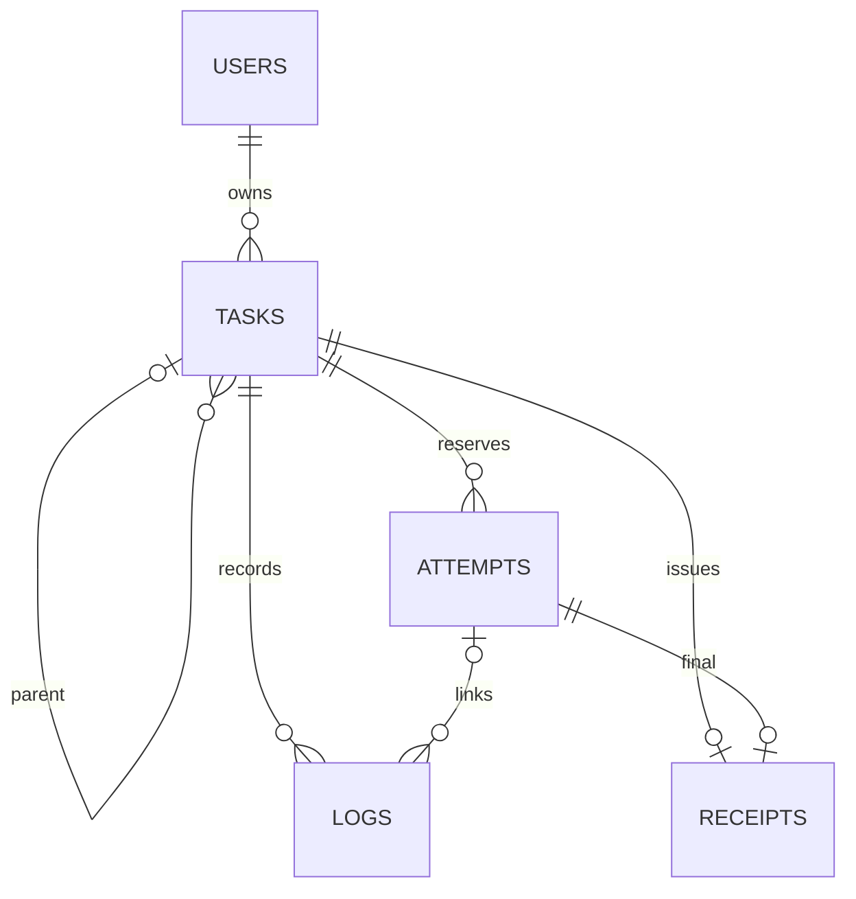

# Mend Supabase schema review — 17 October 2026

## Result

The real project uwkdrmdflzverflcfkgk is named Mend and reports ACTIVE_HEALTHY, PostgreSQL 17.11, Sydney region. The authenticated dashboard and Schema Visualizer were inspected. Three confirmed missing foreign-key indexes were added successfully and verified through Supabase MCP. No rows, grants, policies, ownership, billing or live-execution settings were changed by that migration.

## Verified schema

Four public application tables are present: tasks, task_attempts, logs and receipts. All have primary keys and RLS enabled. Seven foreign-key constraints are validated, including same-owner task lineage and task-scoped attempt references.

USERS represents auth.users; ATTEMPTS represents public.task_attempts. The diagram is an explanation derived from the live catalog, not an exported dashboard image. Composite task/attempt foreign keys prevent cross-task evidence references. Composite parent/owner keys enforce same-owner lineage. A task has at most one receipt.

## Changes applied

Remote migration: 20261017155949_mend_cover_foreign_keys.

| Index | Covered columns |
| --- | --- |
| logs_task_attempt_fk_idx | public.logs(task_id, attempt_id) |
| receipts_task_final_attempt_fk_idx | public.receipts(task_id, final_attempt_id) |
| tasks_parent_owner_fk_idx | public.tasks(parent_task_id, user_id) |

The migration uses 3-second lock waiting and a 15-second statement deadline. These are tiny inspected tables, so ordinary index creation was appropriate. After application, all three indexes are valid and ready. The missing-foreign-key-index advisor category disappeared. No speedup is claimed or benchmarked.

The CLI generated the migration file; its local name was aligned to the actual MCP-recorded remote timestamp and placed in the existing backend/migrations directory. No database reset, local replay, db pull or bulk schema rewrite occurred.

## Real verification

A rollback-only probe used an existing task owner and real service-role RPCs. It verified:

- Draft creation and readback.
- Idempotency returns the same task.
- Exactly one initial draft event.
- Owner visibility through authenticated RLS.
- Cross-owner RPC rejection and RLS invisibility.
- Direct authenticated INSERT is denied.

Probe rows were rolled back. Identity sequence values can advance in PostgreSQL despite rollback; no task/event rows were retained. An unrelated authenticated identity also saw zero tasks, logs, attempts and receipts in a read-only test.

After the index migration, exact row counts remained 3 tasks, 4 logs, 0 attempts, 0 receipts and 0 artifact objects. RLS remained enabled on all four public tables. Live execution remained disabled.

## Access and storage review

- Anonymous roles have no direct read access to the application tables.
- Authenticated access is owner-scoped and excludes expired tasks; child reads join to that same owner/expiry rule.
- Direct browser writes are revoked. Task creation and state changes use the server-only mend_command entrypoint, which is executable by service_role and not anon/authenticated.
- Private helper functions have constrained search paths and no browser execution grants. The private release gate is in a revoked-access schema; its lack of table RLS is not an exposed-table finding.
- mend-artifacts is private; there are no browser Storage policies granting direct access. Storage currently has no artifact objects.
- Database constraints fix the repair cap at 3, execution cap at 4 and job timeout at 60 seconds. This does not prove external runner timing.

## Remaining issues and limits

| Finding | Current status / next action |
| --- | --- |
| Leaked-password protection | Security WARN remains. Supabase documentation limits this feature to Pro and above; the dashboard shows the Free plan. No upgrade or billing change was made. |
| Unused indexes | INFO only: attempts_deadline and the three newly created FK indexes have no recorded use. Tables have almost no execution data. Keep them; do not remove referential/safety indexes merely to clear an advisor. |
| Physical retention | All three existing tasks are past expires_at and remain physically stored. RLS/RPC expiry checks hide them; that is not physical purge. No pg_cron extension or application purge worker was found in the inspected path. Complete and verify a storage-aware purge worker before promising physical deletion. No existing records were deleted. |
| Backups | Dashboard reports “No backups.” No restore drill or external backup was verified. This remains an operational gap before storing important production data. No paid backup feature was enabled. |
| GitHub integration | Dashboard reports no connected repository. Source/migration history in Supabase is not proof of an externally verified GitHub repository or CI pipeline. |
| Live execution | The private release gate is false, monetary cap and evidence reference unset. There are no attempts or live receipts. Provider execution, real cancel-to-stop timing and signing remain incomplete. |
| App integration scope | The probe exercises database RPC/RLS, not a fresh end-to-end FastAPI HTTP or published-site write. The Paper and Proof local case preparation intentionally exports locally and does not create a database task. |
| Scale | No load test or production query benchmark was run. Healthy service status and schema checks do not certify scale readiness. |

The dashboard overview displayed “Advisor found no issues,” while fresh advisor API calls returned the findings above. The fresh advisor results and catalog readback are used as the evidence boundary.

## Evidence and source

- backend/migrations/20261017155949_mend_cover_foreign_keys.sql — exact applied SQL.
- backend/docs/verification/schema-audit-rollback-probe.sql — rollback test.
- docs/verification/supabase-schema-audit-20261017.json — before/after advisors, catalog checks, migration history and probe response.

Official references:

- https://supabase.com/docs/guides/observability/advisors?queryGroups=lint&lint=0001_unindexed_foreign_keys
- https://supabase.com/docs/guides/auth/password-security#password-strength-and-leaked-password-protection
- https://supabase.com/changelog

The changelog was checked; no library/API upgrade was required for this index-only change. The surfaced TLS deprecation concerns old HTTPS clients and does not justify changing the schema or disabling encryption.
